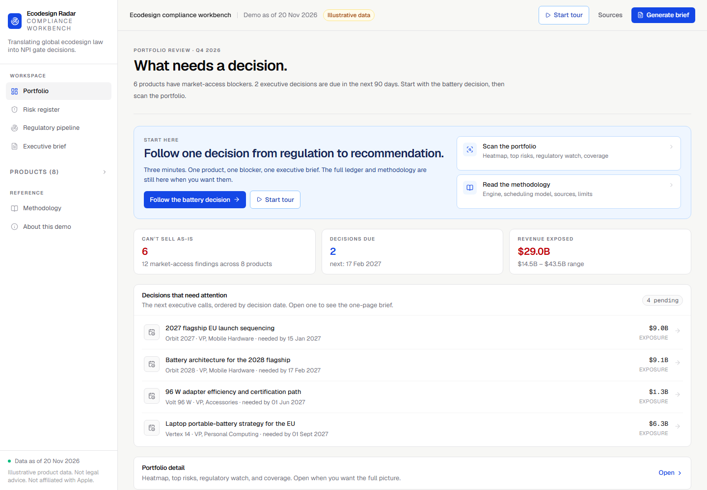

# Hardware Ecodesign Compliance Radar

A portfolio-level compliance workbench for hardware NPI. It turns ecodesign, battery, energy-efficiency, and repairability requirements into product-level assessments, NPI gate deadlines, owners, and executive decisions.



## What it does

- Evaluates hardware specs against 36 clauses across EU, French, and US regimes, with India and the UK tracked as monitoring items.
- Pins each requirement to an NPI lock-in gate and computes the required-by date from qualification lead time and decision buffer.
- Separates applicability, technical conformity, evidence, and program timing — so “unknown” and “evidence missing” stay visible.
- Computes the EU smartphone/tablet repairability class from the official 2023/1669 formula.
- Generates a print-ready one-page executive decision brief with a weighted options matrix.
- Includes a three-minute guided tour and a live “customize this product” what-if panel.

## Hero scenario

The 2028 flagship is professional-serviceable, 1,000-cycle, and IP68 — but not user-removable. EU Battery Regulation Article 11 applies from 18 February 2027. The EVT gate is 15 September 2027, and the decision is due 17 February 2027. The app flags the collision, evaluates the derogation paths, and generates the VP brief.

## Stack

Next.js (App Router), TypeScript, Tailwind CSS, static export. No database, no API keys, no LLM in the compliance path.

## Run locally

```powershell
npm install
npm run dev
```

Open http://localhost:3000.

## Quality checks

```powershell
npm run check
```

Runs typecheck, lint, tests, regulatory data validation, and a production build.

## Deploy

Import the repo into Vercel. Use the Next.js preset, build with `npm run build`, and output `out`. No environment variables are required.

## Documentation

- [Detailed project overview](docs/project-overview.md)
- [Regulatory sources and scope corrections](docs/sources.md)
- [Original architecture notes](docs/ed-radar-architecture.md)
- [Case-study draft](docs/description-writeup.md)

## Disclaimer

Product and program data are illustrative. Regulatory data is a curated snapshot last verified on 20 November 2026. Not legal advice. Not affiliated with Apple.

## License

MIT. See [LICENSE](LICENSE).
