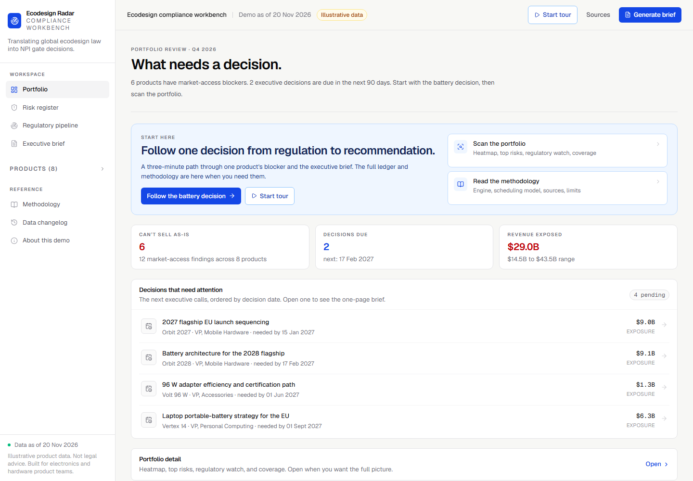
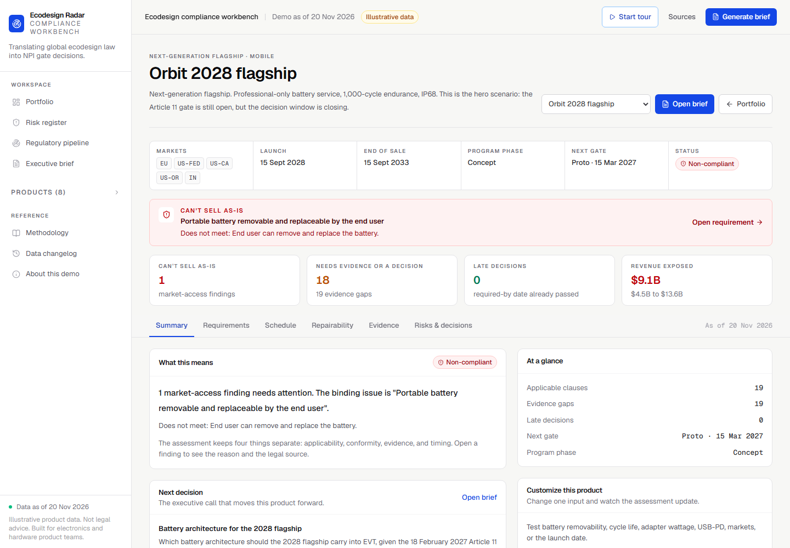
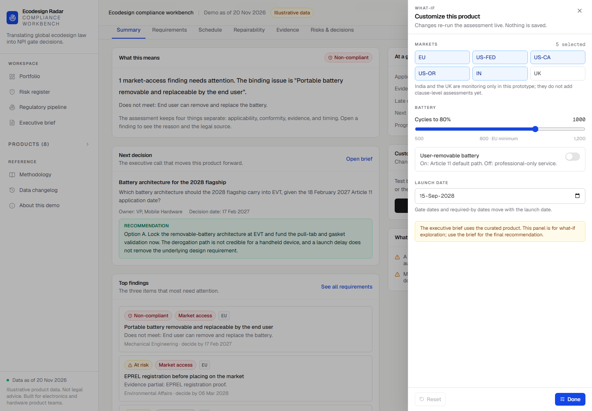
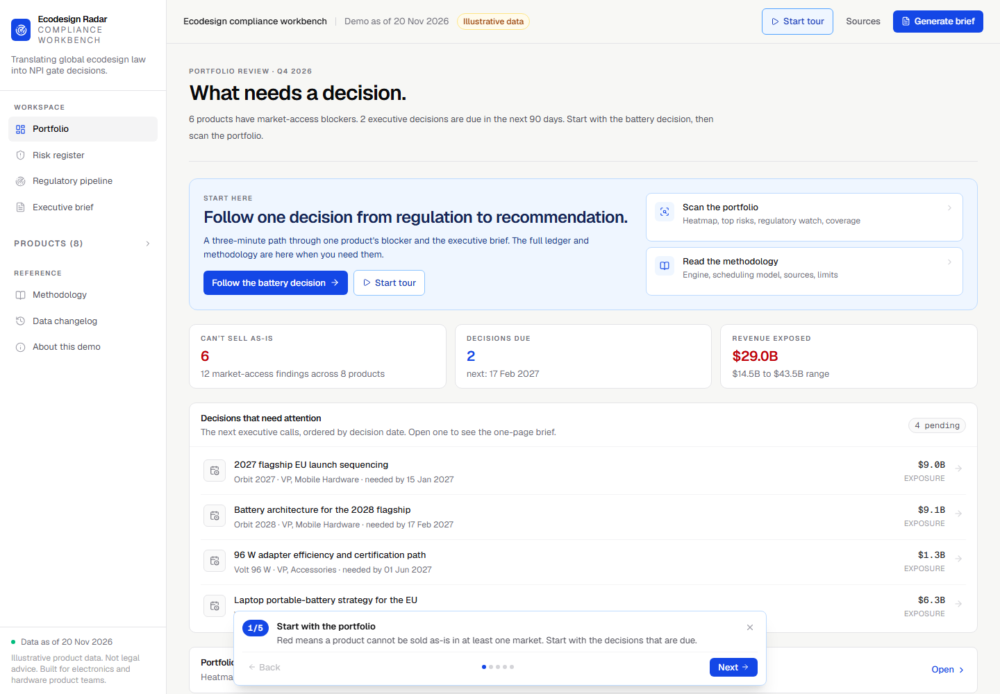
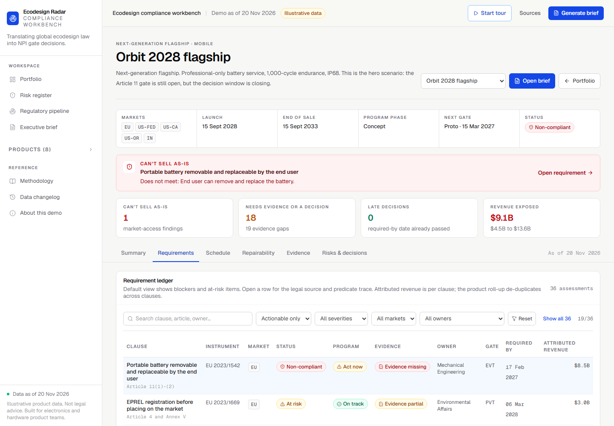

# Hardware Ecodesign Compliance Radar

A portfolio-level compliance workbench for hardware NPI. It turns ecodesign, battery, energy-efficiency, and repairability requirements into product assessments, NPI gate deadlines, owners, and executive decisions.

**Live demo:** https://hardware-ecodesign-compliance-radar.vercel.app/

> **Status:** working prototype. The hero scenario is a 2028 flagship smartphone and the EU Battery Regulation Article 11 decision. Product and program data are illustrative.

## Who it is for

Built for product environmental compliance teams at electronics and hardware companies, including Apple, Amazon, Samsung, Siemens, and similar OEMs. The product set covers consumer devices, accessories, and industrial hardware.

## Why this exists

Hardware teams often discover regulatory applicability after the enclosure, battery, or BOM is frozen. At that point, a design change is expensive. The workbench keeps four things separate:

1. The law: instrument, article, application date, transition.
2. The interpretation: settled, guidance, contested, or pending.
3. The evidence: test reports, declarations, certificates, registry entries.
4. The program: owner, gate, lead time, decision buffer.

Most tools merge these into one status. The workbench shows each one, so "unknown" and "evidence missing" stay visible.

## The hero scenario

**Orbit 2028 flagship, EU launch, Battery Regulation Article 11.**

- Article 11 applies from 18 February 2027.
- The EVT gate is 15 September 2027.
- With 24 weeks of qualification lead time and a 6-week decision buffer, the required-by date is 17 February 2027.
- The battery is 1,000-cycle, IP68, and professional-serviceable, but not user-removable.
- The wet-environment and wearable derogations do not fit a handheld smartphone.
- The decision is due inside 90 days, so the app marks it "Act now" and generates the VP brief.

The 2027 flagship is the counter-example. Its required-by date has already passed. The portfolio shows both the cost of a late decision and the value of an early one.

## What's inside

| View | What it does |
|---|---|
| Portfolio review | Product and regulation heatmap, market-access blockers, exposure, decisions due, top risks, regulatory watch |
| Requirement ledger | Every applicable clause with status, evidence, owner, gate, required-by date, legal text, interpretation, and predicate trace |
| NPI Gantt | Backward-scheduled decision windows from the lock-in gate, with late, act-now, and monitor states |
| Repairability scorecard | EU smartphone and tablet repairability class, part-level inputs, design levers, and an illustrative France index for laptops |
| Evidence | Missing, partial, ready, and expired artifacts, filtered to gaps by default |
| Risks and decisions | 5 × 5 risk heatmap, owners, mitigations, contingencies, and links to briefs |
| Executive brief | One-page decision artifact with the ask, exposure, weighted options, recommendation, dissent, owners, and gates |
| Regulatory pipeline | Delegated acts, standards, consultations, and advocacy positions |
| Data changelog | Reviewed data releases and the watch queue |
| Methodology | The four-state model, tri-state engine, scheduling formula, repairability formula, scope decisions, sources, and limits |

## Screenshots

| Portfolio review | Requirement ledger |
|---|---|
|  |  |

| Product summary | Customize this product |
|---|---|
|  |  |

| Guided tour | Requirements: actionable first |
|---|---|
|  |  |

| Backward-scheduled NPI windows | Repairability scorecard |
|---|---|
|  |  |


More views: [risk register](screenshots/risks.png) · [regulatory pipeline](screenshots/pipeline.png) · [data changelog](screenshots/changelog.png) · [methodology](screenshots/methodology.png) · [mobile portfolio](screenshots/portfolio-mobile.png)

## Architecture

```text
Next.js App Router (static export)
├── src/app                 routes and layouts
├── src/components          presentation only
├── src/domain              pure TypeScript: predicates, engine, schedule, scoring, brief
├── src/data                versioned regulatory and product datasets
├── src/lib                 dates, formatting, helpers
├── scripts                 data validation and screenshots
└── tests                   unit, scenario, and golden tests
```

Key choices:

- Static-first. `output: "export"`, no database, no API keys, no server runtime.
- Deterministic core. Regulatory applicability is a typed predicate tree.
- Three-valued logic. Missing data returns `"unknown"`, not `false`.
- Traceable results. Every assessment carries the predicate branch, actual value, expected value, and a readable reason.
- No LLM in the compliance path. The brief is generated from structured findings.

The domain layer has no React or Next.js imports. It can be tested, reused, or moved into a server-side tool without rewriting the rules.

## Data scope

The snapshot covers 13 instruments and 36 clauses:

- EU 2023/1670 (smartphones and tablets)
- EU 2023/1542 (Batteries Regulation)
- EU 2025/2052 (external power supplies and charging equipment)
- EU 2023/1669 (smartphone and tablet energy label)
- EU 2024/1781 (ESPR and DPP)
- EU 2019/2021 (electronic displays)
- EU 617/2013 (computers)
- France repairability index
- US California and Oregon right-to-repair
- US DOE, CEC, and ENERGY STAR
- India e-waste EPR (monitoring only)

Scope decisions that shaped the model:

- Battery Passport does not apply to portable batteries. Article 77 covers LMT, EV, and industrial batteries above 2 kWh.
- Article 11 derogations are narrow and evidence-based. An IP rating alone is not a sufficient wet-environment justification. A handheld smartphone is not a wearable.
- The 2023/1670 500-cycle/83% and 1,000-cycle/80% + IP67 conditions are a conjunction for the professional-only battery availability path. They do not replace the 800-cycle requirement.
- The EU repairability class is not the French index. Smartphones and tablets use the EU label class. France's index still applies to laptops.
- The ESPR ICT delegated act is expected in 2029, with an approximately 18-month transition.
- EU 2025/2052 has four dates: early compliance (14 Dec 2025), general application (14 Dec 2028), >100 W USB-PD efficiency transition (14 Dec 2030), and spare-part EPS (14 Dec 2033).

Full sources and last-verified dates are in [sources.md](sources.md).

## Keeping data current

The dataset is a reviewed snapshot. A weekly GitHub Action checks the official sources. When a source changes, it opens a pull request with a candidate. A human verifies the source, updates the clause, adds a changelog entry, and merges. Vercel then rebuilds the static app.

The app shows the last verified date, the next review date, and the watch queue. The action never rewrites a legal threshold or an applicability rule.

- [Update runbook](regulatory-update-runbook.md)
- [Data changelog](https://hardware-ecodesign-compliance-radar.vercel.app/changelog/)

## Run locally

Requires Node.js 22 or newer.

```powershell
npm install
npm run dev
```

Open http://localhost:3000.

### Quality checks

```powershell
npm run check
```

This runs typecheck, lint, tests, data validation, and a production build.

## Deploy

1. Push the repo to GitHub.
2. Import it into Vercel.
3. Use the Next.js preset.
4. Build with `npm run build`.
5. Set the output directory to `out`.
6. Use Node 22.x.
7. No environment variables are required.

A subdomain such as `radar.raka-adrianto.com` is simpler than a subpath. If you use `/compliance-radar`, set `basePath: "/compliance-radar"` in `next.config.ts` and test every asset path.

## Limitations

- Illustrative product and program data. It does not come from a specific company.
- Curated regulatory snapshot. Not legal advice.
- Generic gate offsets. Real OEM gates vary by program.
- The France laptop score is illustrative until the category arrêté is encoded.
- US and India data are lower-confidence and labelled.
- No live PLM/BOM, supplier, LCA, EPREL, SCIP, or DPP registry integration.
- No auth, workflow, notifications, or audit log.
- The demo date is fixed at 20 November 2026 to keep the example stable.

## Reference

The original role research is kept in [reference/job-ad.md](reference/job-ad.md) for context. The app itself is vendor-neutral.

## License

MIT. See [../LICENSE](../LICENSE).

> Product and program data are illustrative. Regulatory data is a curated snapshot last verified on 20 November 2026. Not legal advice. Not affiliated with any hardware manufacturer.
