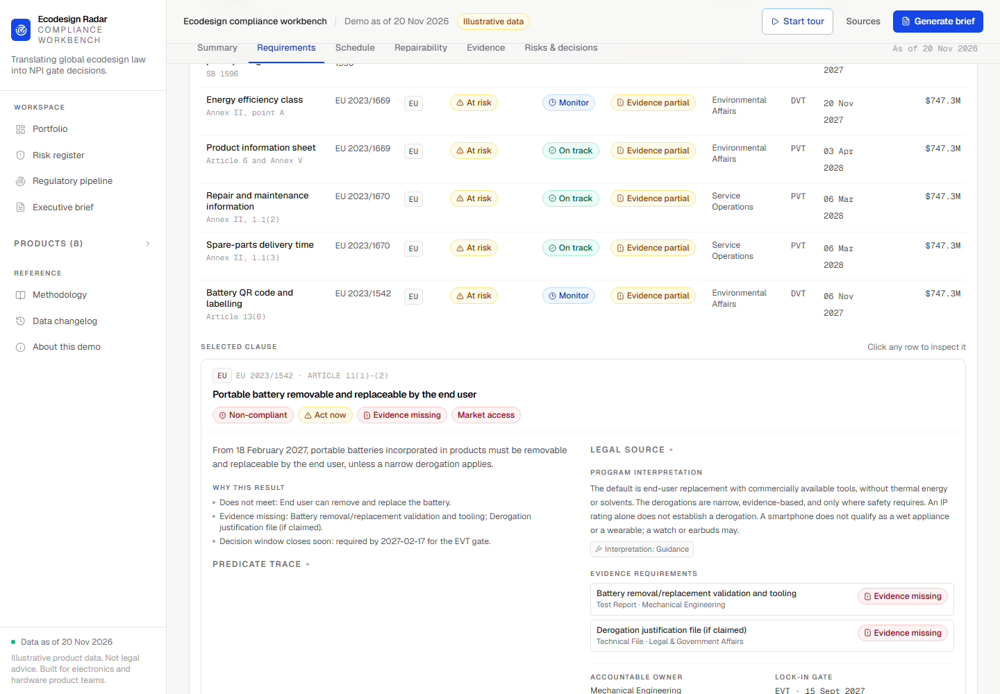
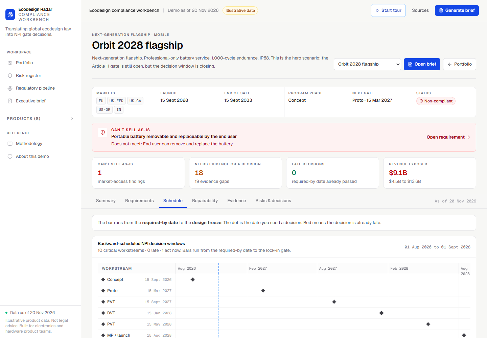
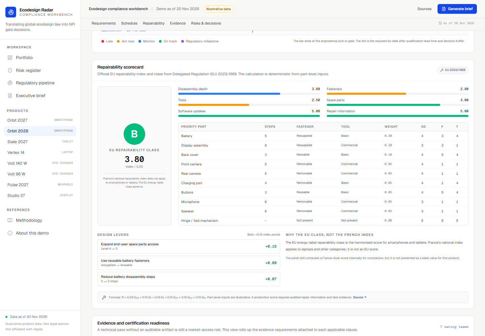
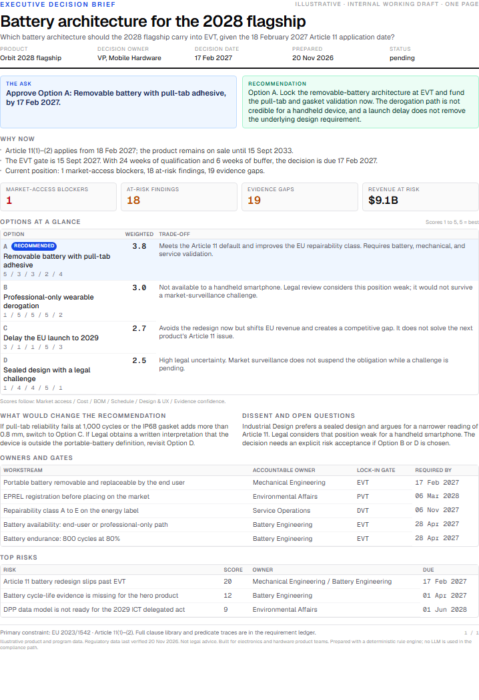

# Ecodesign Compliance Radar

A portfolio-level NPI compliance workbench that turns ecodesign law into gate decisions, owner assignments, and executive trade-offs.

> **Status:** first vertical slice. The hero scenario is a 2028 flagship smartphone and the EU Battery Regulation Article 11 removability decision. Product and program data are illustrative; regulatory data is a curated snapshot with sources.

---

## Why this exists

Hardware programs rarely fail compliance because the law is unknown. They fail because applicability is discovered after the enclosure, battery, or BOM is frozen.

Most compliance tools collapse four different things into one status:

1. **What the law says** — instrument, article, application date, transition.
2. **How we interpret it** — settled, guidance, contested, or pending.
3. **Whether we can prove it** — test reports, declarations, certificates, registry entries.
4. **Whether the program can still act** — owner, lock-in gate, lead time, decision buffer.

The Radar keeps them separate. That separation is the product.

---

## What’s inside

| View | What it does |
|---|---|
| **Portfolio review** | Product × regulation heatmap, market-access blockers, exposure, decisions due, top risks, regulatory watch |
| **Requirement ledger** | Every applicable clause with status, evidence, owner, gate, required-by date, legal text, interpretation, and predicate trace |
| **NPI Gantt** | Backward-scheduled decision windows from the lock-in gate, with late/act-now/monitor states and regulatory milestones |
| **Repairability scorecard** | Official EU smartphone/tablet repairability index and class, part-level inputs, design levers, and an illustrative France index for laptops |
| **Risk register** | 5 × 5 heatmap, likelihood × impact, owners, mitigations, contingencies, decision links |
| **Executive brief** | One-page, print-ready decision artifact with a one-line ask, exposure, weighted options, recommendation, dissent, owners, and gates |
| **Regulatory pipeline** | Delegated acts, standards, consultations, and advocacy positions — the “influence” half of the role |
| **Methodology** | The four-state model, tri-state engine, scheduling formula, repairability formula, scope corrections, sources, limitations |

---

## The hero scenario

**Orbit 2028 flagship — EU launch — Battery Regulation Article 11.**

- Article 11 applies from **18 February 2027**.
- The product’s EVT gate is **15 September 2027**.
- With 24 weeks of qualification lead time and a 6-week decision buffer, the required-by date is **17 February 2027**.
- The battery is 1,000-cycle, IP68, and professional-serviceable — but **not user-removable**.
- The wet-environment and wearable derogations do not fit a handheld smartphone.
- The decision is due **inside 90 days**; the app flags it as **Act now** and generates the VP brief.

The 2027 flagship is the counter-example: its required-by date has already passed. The portfolio shows both the consequence of a late decision and the value of an early one.

---

## Screenshots

| Portfolio review | Requirement ledger |
|---|---|
|  |  |

| Backward-scheduled NPI windows | Repairability scorecard |
|---|---|
|  |  |



More views: [risk register](screenshots/risks.png) · [regulatory pipeline](screenshots/pipeline.png) · [methodology](screenshots/methodology.png) · [mobile portfolio](screenshots/portfolio-mobile.png)

---

## Architecture

```text
Next.js App Router (static export)
├── src/app                 routes and layouts
├── src/components          presentation only
├── src/domain              pure TypeScript: predicates, engine, schedule, scoring, brief
├── src/data                versioned regulatory + product datasets
├── src/lib                 dates, formatting, helpers
├── scripts                 data validation
└── tests                   unit, scenario, and golden tests
```

Key choices:

- **Static-first.** `output: "export"`; no database, no API keys, no server runtime. The demo has zero cold-start and can run on any static host.
- **Deterministic core.** Regulatory applicability is a typed predicate tree, not a string, regex, or LLM prompt.
- **Tri-state logic.** Missing data returns `"unknown"`, not `false`. A missing battery-cycle value must never silently become “not applicable.”
- **Traceable results.** Every assessment carries the predicate branch, actual value, expected value, and a human-readable rationale.
- **No LLM in the compliance path.** The brief is generated from structured findings. An optional drafting assistant is a future extension, not a dependency.

The domain layer has no React or Next.js imports. It can be tested, reused, or moved into a server-side tool without rewriting the rules.

---

## Data scope

The snapshot covers 13 instruments and 36 clauses across:

- EU 2023/1670 (smartphones and tablets)
- EU 2023/1542 (Batteries Regulation)
- EU 2025/2052 (external power supplies and charging equipment)
- EU 2023/1669 (smartphone/tablet energy label)
- EU 2024/1781 (ESPR / DPP)
- EU 2019/2021 (electronic displays)
- EU 617/2013 (computers)
- France repairability index
- US California and Oregon right-to-repair
- US DOE / CEC and ENERGY STAR
- India e-waste EPR (monitoring only)

Scope corrections that shaped the model:

- **Battery Passport does not apply to portable batteries.** Article 77 covers LMT, EV, and industrial batteries above 2 kWh. A smartphone is outside it.
- **Article 11 derogations are narrow and evidence-based.** An IP rating alone is not a sufficient wet-environment justification. A handheld smartphone is not a wearable.
- **The 2023/1670 500-cycle/83% and 1,000-cycle/80% + IP67 conditions are a conjunction** for the professional-only battery availability path, not alternatives to the 800-cycle requirement.
- **The EU repairability class is not the French index.** Smartphones/tablets use the EU label class; France’s index still applies to laptops.
- **The ESPR ICT delegated act is expected in 2029**, with an approximately 18-month transition. DPP is a readiness problem now, not a current smartphone obligation.
- **EU 2025/2052 has four dates**: early compliance (14 Dec 2025), general application (14 Dec 2028), >100 W USB-PD efficiency transition (14 Dec 2030), and spare-part EPS (14 Dec 2033).

Full sources and last-verified dates are in [`docs/sources.md`](sources.md) and on the `/methodology` page.

---

## Run locally

Requires Node.js 22+.

```powershell
npm install
npm run dev
```

Open http://localhost:3000.

### Quality checks

```powershell
npm run check
```

This runs typecheck, lint, 46+ unit/scenario tests, data validation, and a production build.

Individual commands:

```powershell
npm run typecheck
npm run lint
npm test
npm run validate:data
npm run build
npm run preview
```

---

## Deploy to Vercel

1. Push the repo to GitHub.
2. Import the repo into Vercel.
3. Framework preset: **Next.js**.
4. Build command: `npm run build`.
5. Output directory: `out` (the project uses `output: "export"`).
6. Node version: 22.x.
7. No environment variables are required.

A subdomain such as `radar.raka-adrianto.com` is simpler than a subpath. If you use `/compliance-radar`, set `basePath: "/compliance-radar"` in `next.config.ts` and test every asset path.

---

## Repo layout

```text
docs/                 sources, architecture notes, role research
scripts/              data validation
src/app/              routes
src/components/       UI primitives and views
src/data/             instruments, clauses, products, risks, decisions, milestones, DPP
src/domain/           types, predicates, engine, schedule, scoring, brief
src/lib/              date and formatting helpers
tests/                predicates, schedule, scoring, engine, data, brief
```

---

## Limitations

- Illustrative product/program data; not Apple data.
- Curated regulatory snapshot; not legal advice.
- Generic gate offsets; real OEM gates vary by program.
- France laptop score is illustrative until the category-specific arrêté is encoded.
- US and India data are lower-confidence and labelled.
- No live PLM/BOM, supplier, LCA, EPREL, SCIP, or DPP registry integration.
- No auth, workflow, notifications, or audit log.
- Demo date is fixed at **20 Nov 2026** to prevent rot.

---

## License

MIT. See [LICENSE](../LICENSE).

> Not affiliated with Apple. Product names and program data are illustrative. Regulatory data is provided for demonstration and must be verified against the primary sources before use.

